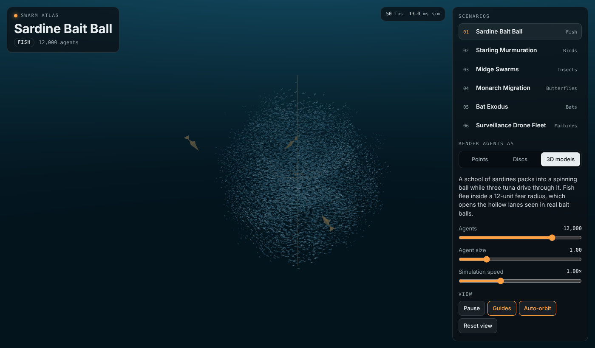
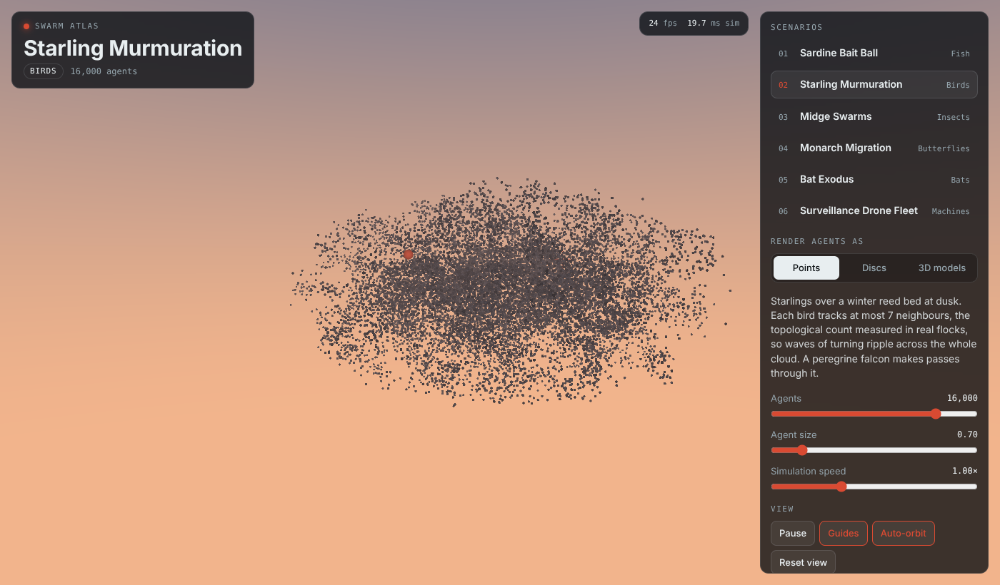
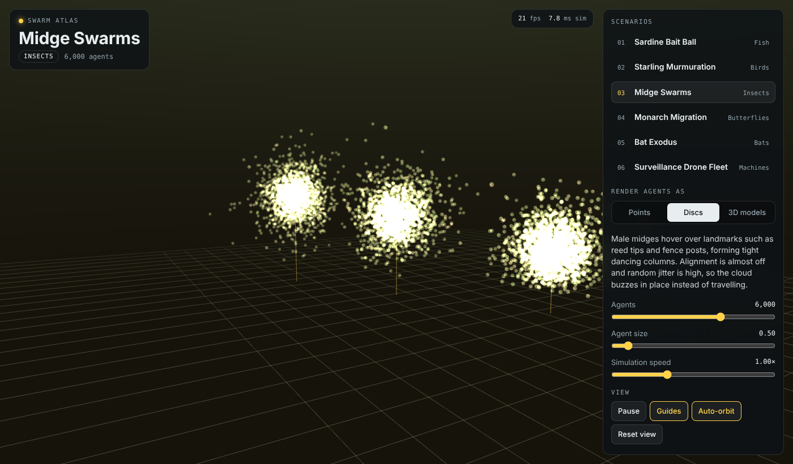
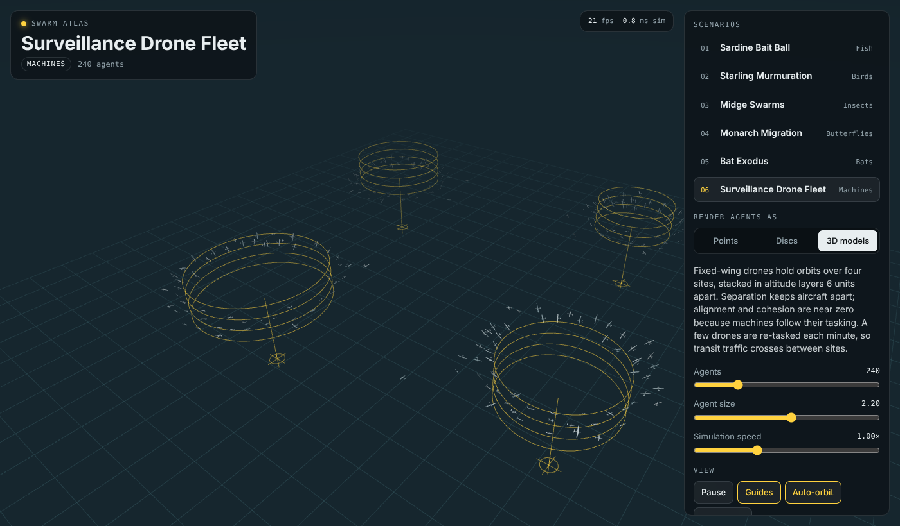

# Swarm Atlas

A WebGL2 showcase of collective motion. Thousands of agents (fish, birds, insects, butterflies, bats and drones) are simulated in real time with boids rules and rendered as points, textured discs or low-poly 3D models. Every scenario is plain JSON, so you can export, edit and import new ones.



| Starling murmuration | Midge swarms | Surveillance drone fleet |
|---|---|---|
|  |  |  |

## Run it

It is a single static file with no build step and no dependencies.

```bash
git clone https://github.com/mykkro/swarmz.git
cd swarmz
open index.html            # or double-click it
# or serve it:
python3 -m http.server 8000   # then visit http://localhost:8000
```

To host it, enable **GitHub Pages** (Settings → Pages → deploy from branch `main`, folder `/`).

## Scenarios

| # | Scenario | Agents | What it shows |
|---|---|---|---|
| 1 | Sardine Bait Ball | 12,000 fish | Vortex-spun school; three tuna punch hollow lanes through it |
| 2 | Starling Murmuration | 16,000 birds | Each bird follows at most 7 neighbours; a falcon makes passes |
| 3 | Midge Swarms | 6,000 insects | Tight buzzing clouds hovering over landmarks |
| 4 | Monarch Migration | 5,000 butterflies | A continuous stream following a waypoint corridor |
| 5 | Bat Exodus | 10,000 bats | A corkscrew column rising out of a cave, then streaming away |
| 6 | Surveillance Drone Fleet | 240 aircraft | Fixed-wing drones loitering over four sites in altitude layers, with periodic re-tasking |

## Controls

- **Orbit:** drag · **Zoom:** scroll or pinch · **Pan:** right-drag, Shift-drag or two fingers · **Reset view:** double-click or double-tap
- **Keys:** `1`–`9` switch scenario, `Space` pause, `G` toggle guides
- The panel switches render mode, agent count (up to 60,000), size and simulation speed. On phones it becomes a collapsible bottom sheet.

## Scenario JSON

**Edit JSON** shows the current scenario (or all of them) for in-place editing. **Save .json** and **Open .json** write and read files. Importing a scenario whose `id` matches an existing one replaces it; a new `id` adds it to the list. `scenarios/all-scenarios.json` contains the six built-in scenarios.

```jsonc
{
  "version": 1,
  "id": "sardine-bait-ball",
  "name": "Sardine Bait Ball",
  "kind": "Fish",
  "description": "…",
  "agents":  { "count": 12000, "model": "fish", "size": 1.0 },      // fish | bird | bat | insect | butterfly | plane
  "render":  { "mode": "models",                                      // points | discs | models
               "sky": ["#03141d", "#1c6c8c"],                         // horizon, zenith
               "fogColor": "#0a3346", "fog": 0.01,
               "palette": ["#dfeaf0", "#6d93a8"], "accent": "#ff9f43",
               "blend": "alpha",                                      // alpha | additive (glow)
               "ground": null, "gridColor": "#ffffff" },              // ground: { "y", "size", "step" }
  "bounds":  { "shape": "sphere", "center": [0,0,0], "radius": 46,    // sphere | box (uses halfSize)
               "halfSize": [46,46,46], "floor": null, "force": 2.0 },
  "boids":   { "neighborRadius": 4.5, "separationRadius": 1.6,
               "separation": 1.8, "alignment": 1.2, "cohesion": 0.8,
               "maxSpeed": 16, "minSpeed": 7, "maxForce": 30,
               "noise": 0.15, "maxNeighbors": 20 },
  "behaviors": [ /* see below */ ],
  "simulation": { "speed": 1 },
  "camera":  { "distance": 125, "yaw": 0.7, "pitch": 0.15, "target": [0,0,0], "autoRotate": 0.06 }
}
```

### Behaviors

| `type` | Fields | Effect |
|---|---|---|
| `vortex` | `center`, `strength`, `radius?` | Swirl around a vertical axis |
| `attractor` | `position`, `strength`, `motion? {amp[3], freq[3]}` | Pull toward a point, optionally drifting on a Lissajous path |
| `markers` | `points[]`, `strength`, `hover` | Agents split evenly among the points and hover around them |
| `waypoints` | `points[]`, `strength`, `reach`, `spread`, `spreadGrowth`, `loop` | Per-agent path following. Without `loop`, agents respawn at the start for an endless stream |
| `loiter` | `sites[{position, radius}]`, `altitude`, `layers`, `layerSpacing`, `strength`, `reassignPerMinute` | Orbit assigned sites in stacked altitude layers, with random re-tasking |
| `predator` | `count`, `model?`, `scale`, `speed`, `force`, `fearRadius`, `fearStrength`, `retargetSeconds` | Hunters chase random prey; prey flee inside the fear radius |

Unknown fields are ignored and out-of-range values are clamped on import.

## How it works

- **Simulation (CPU):** Reynolds boids on a uniform grid rebuilt each step with a counting sort. Each agent scans its own cell first, then the neighbouring cells, and stops after `maxNeighbors` matches or a fixed number of checks. This keeps a step at about 3–7 ms for 5–16k agents on a laptop.
- **Rendering (WebGL2):** one interleaved instance buffer (position, velocity, bank, phase) uploaded each frame and drawn instanced.
  - Points use `gl.POINTS`.
  - Discs are velocity-aligned billboards with a procedural texture.
  - Models are flat-shaded low-poly meshes, oriented by velocity and banked into turns, with wing flap or tail swing driven in the vertex shader.
  - The sky gradient and distance fog are computed per scenario.

## License

[MIT](LICENSE)
